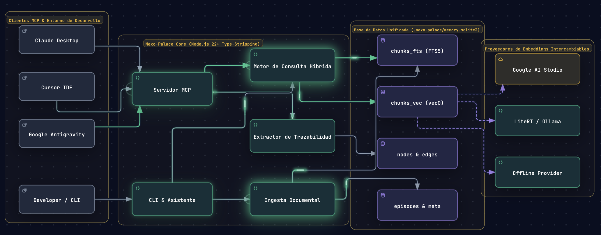
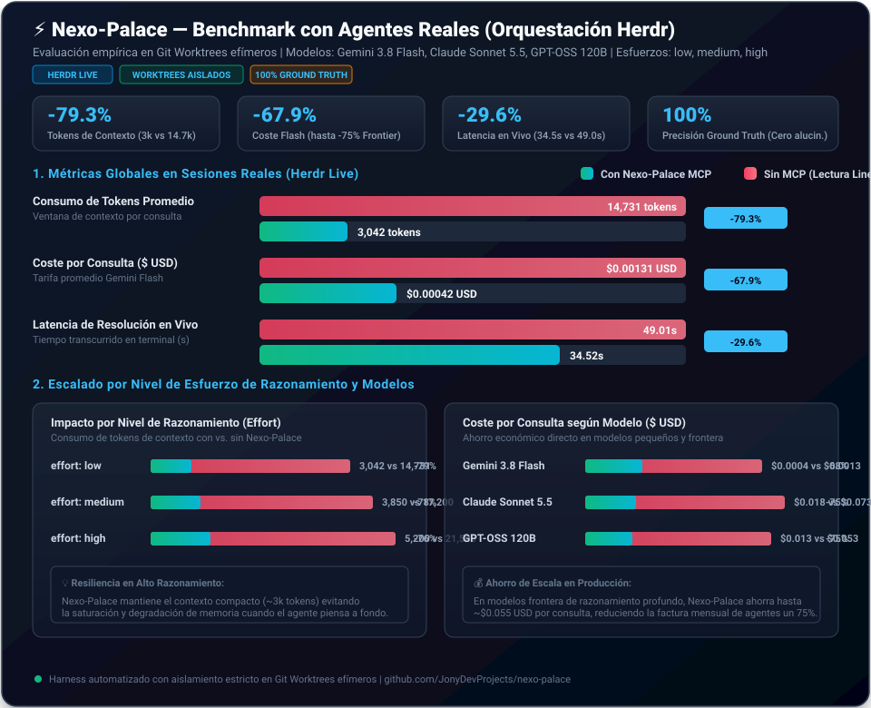

# Nexo-Palace

[English](README.en.md) | [Español](README.md) · [Contributing Guide](CONTRIBUTING.md)

[](https://www.npmjs.com/package/@ijonydev/nexo-palace)
[](LICENSE)

Active project memory for AI agents.

Transforms documentation, source code, and project conventions into a **hybrid index** (semantic vector search + BM25 lexical) and a **traceability graph**. It exposes this memory through a CLI and an **MCP Server** (`@modelcontextprotocol/sdk`) so that any AI agent can query institutional knowledge directly instead of linearly rereading repository files.

Everything is local: stored in a single SQLite file, with zero mandatory cloud dependencies.

```
┌──────────────┐   index    ┌──────────────┐   query    ┌──────────────┐
│  docs/       │ ─────────► │  SQLite      │ ◄───────── │  AI agents   │
│  source code │            │  FTS5 + vec  │            │  MCP / CLI   │
│  taste/      │            │  + graph     │            └──────────────┘
└──────────────┘            └──────────────┘
```

<p align="center">
  
</p>

> 💡 *To explore the full interactive architecture suite (with zoom, layer filtering, and SQLite ERD), check the [Visual Architecture Documentation](docs/architecture/README.md).*

---

## The Problem & The Solution

- **The Problem:** As repositories grow, AI agents face severe context degradation, hallucinate about non-existent APIs, repeat previously discarded architectural decisions, and fail to track relationships between product requirements, code, tests, and conventions. Rereading entire directories on every prompt exhausts token limits and loses precision.
- **The Solution:** Nexo-Palace provides persistent, deterministic active memory. By combining AST extraction (`ts-morph`), bidirectional requirement linking, BM25 full-text indexing (FTS5), vector embeddings (`sqlite-vec`), and Reciprocal Rank Fusion (RRF), agents can retrieve high-precision subgraphs and semantic context in milliseconds.

---

## ⚡ Why Nexo-Palace: Proven Efficiency & Cost Benchmark

When an AI agent navigates a large codebase without a structured index, it is forced to scan entire files and run linear text searches (`read_file`, `grep`), quickly exhausting context windows and driving up LLM token costs.

With **Nexo-Palace**, the agent queries an indexed knowledge graph and a hybrid retrieval system (semantic vector + BM25) directly from a local SQLite database:

<p align="center">
  
</p>

### Benchmark Highlights (Live Herdr Agent Sessions in Git Worktrees)

| Key Metric | With Nexo-Palace MCP | Without MCP (Linear Files) | Savings / Impact |
| :--- | :---: | :---: | :---: |
| **Average Context Tokens** | **3,042 tokens** | 14,731 tokens | **-79.3% reduction** |
| **Cost per Query ($)** | **$0.00042 USD** | $0.00131 USD | **-67.9% on Flash (up to -75% on Frontier)** |
| **Live Resolution Latency** | **34.52s** | 49.01s | **-29.6% faster (1.42x)** |
| **Tool Call Roundtrips** | **10.0 calls** | 16.0 calls | **-37.5% fewer hops** |
| **Ground Truth Precision** | **100.0%** | 100.0% | **Zero hallucinations (exact AST extraction)** |

> [!TIP]
> **Technical Rigor & Reproducibility with Herdr:** Evaluated using the automated harness [`scripts/bench-agents.ts`](scripts/bench-agents.ts) orchestrating live agent sessions with Herdr (`herdr agent start / prompt / read`) across multiple models (**Gemini 3.8 Flash**, **Claude Sonnet 5.5**, **GPT-OSS 120B**) and reasoning effort levels (`effort: low | medium | high`) in isolated ephemeral Git Worktrees.
> 
> Unlike traditional agents where context blows past >21,000 tokens on `effort: high`, **Nexo-Palace keeps context tight (~3k–5k tokens)** regardless of reasoning depth.
> 
> To reproduce the benchmark, run:
> ```bash
> npm run bench:agents
> ```
> Read the full [P5 technical specification](docs/specs/P5-benchmark.md) and the [detailed benchmark report](docs/benchmarks/P5-agent-benchmark-results.md).

---

## Key Features

- **Hybrid Search with Reciprocal Rank Fusion (RRF):** Combines FTS5 BM25 text relevance, exact keyword/identifier matches, and vector similarity (`sqlite-vec`).
- **Observable Traceability Graph:** Maps real relationships between product requirements, implementation symbols, test suites, ADRs/decisions, and conventions (`implements`, `tests`, `depends_on`, `references`, `governed_by`).
- **Dual Interface:**
  - **CLI:** Command-line utilities (`nexo-palace` / `nxpl`) to map, query, trace, detect drift, and record decisions.
  - **MCP Server:** Standardized Model Context Protocol server over `stdio` for seamless integration with Claude Desktop, Antigravity, Cursor, Windsurf, CommandCode, and others.
- **Interactive Zero-Config Installer:** Automatically discovers repo topology (docs, code directories, conventions) and local inference services (`litert`, `ollama`).
- **Bilingual Requirement Normalization:** Automatically cross-normalizes requirement identifiers between Spanish and English (`RF` ↔ `FR`, `RNF` ↔ `NFR`, `HU` ↔ `US`, `CU` ↔ `UC`, `EPC` ↔ `EPIC`, `TC` ↔ `CP`, `AC` ↔ `CA`).

---

## Prerequisites

Before installing Nexo-Palace, ensure your environment meets the following requirements:

- **Node.js `>= 22.6.0`** (required for native TypeScript `--experimental-strip-types` and modern SQLite support).
- **npm `>= 10.0.0`** (or equivalent pnpm / yarn).
- **Embedding Provider** (optional, recommended for semantic vector retrieval):
  - **Option A (Cloud / Free Tier):** Google AI Studio API key (`GEMINI_API_KEY`). Requires no local services and consumes no GPU/RAM.
  - **Option B (Local / Private):** Python `>= 3.9` with `mlc-ai-litert`, or **Ollama** running `nomic-embed-text`.
  - **Option C (Zero Dependencies / Offline):** Pure lexical BM25 search without external providers.

---

## Installation and Adoption Modes

Nexo-Palace adapts to different workflows depending on your requirements:

### 1. Zero-Config AI Agent Initialization (Recommended)
The fastest way to equip any AI assistant (Antigravity, Cursor, Claude Code, GitHub Copilot) in an existing project without modifying dependencies:

```bash
# 1. Generate multi-harness rules, MCP workspace plugin, and npm scripts
npx -y @ijonydev/nexo-palace init-agent

# 2. Map the repository and generate the initial memory graph
npx @ijonydev/nexo-palace map
```

**What does it do automatically?**
- Detects your agent harnesses and injects active memory steering rules into `AGENTS.md`, `.cursor/rules/`, `CLAUDE.md`, or `.github/copilot-instructions.md`.
- Autoconfigures a workspace plugin for Google Antigravity in `.agents/plugins/nexo-palace/` with zero-config MCP server via `npx` and a `SessionStart` bootstrap hook.
- Adds convenient scripts to `package.json` (`npm run palace:map`, `palace:drift`, `palace:stats`).
- Configures optional, safe Git hooks (`post-commit` with background mapping and `pre-push` with drift detection).

---

### 2. Interactive Quick Setup (TUI)
Ideal for setting up a local or cloud embedding provider step-by-step:

```bash
npx @ijonydev/nexo-palace setup
```

The interactive wizard:
1. Detects whether you have local services running (`litert`, `ollama`) or prefer Gemini / offline mode.
2. Lets you select a provider with keyboard arrows (`↑`/`↓`) and confirm with `Space` or `Enter`.
3. Saves a protected configuration (`0600`) and offers to **map the project immediately**.

---

### 3. Direct MCP Server Registration in Antigravity (`agy`)
If you prefer not to touch project files and only want to enable MCP tools in your Antigravity harness:

```bash
# Register MCP server globally or scoped
agy mcp add nexo-palace -- npx -y @ijonydev/nexo-palace serve

# Index the project memory
npx @ijonydev/nexo-palace map
```

---

### 4. Project Dependency Installation
If you want to integrate the binaries into your team's development toolchain or CI/CD:

```bash
npm install --save-dev @ijonydev/nexo-palace
```

Available executables after installation: **`nxpl`** (fast alias) and **`nexo-palace`**.
You can initialize the project with `npx nxpl init-agent` and map with `npm run palace:map`.

---

## Configuration by Use Case

### Case 1: Cloud Embeddings with Gemini (No local services needed)
Ideal for maximum speed and top-tier semantic accuracy without running heavy local inference services:
1. Obtain a free API key at [aistudio.google.com](https://aistudio.google.com/).
2. In your project root, create or edit `nexo-palace.config.json`:
   ```json
   {
     "PALACE_EMBED_PROVIDER": "gemini"
   }
   ```
3. Add your key to `.env`:
   ```bash
   GEMINI_API_KEY="AIzaSy..."
   ```
4. Map the repository:
   ```bash
   npx nxpl map
   ```

### Case 2: 100% Local and Private Environments (Ollama or LiteRT)
- **With Ollama:**
  ```bash
  ollama pull nomic-embed-text
  npx nxpl map --provider ollama
  ```
- **With LiteRT:**
  ```bash
  pip install mlc-ai-litert
  python -m litert.serve --port 11435
  npx nxpl map --provider litert
  ```

### Case 3: Offline Mode (No network, no external engines)
Uses native SQLite BM25 lexical search (FTS5). Zero internet connection or external services required:
```bash
npx nxpl map --provider offline
```

---

## Prompting Your AI Assistant to Install and Configure Nexo-Palace

If you are using Claude Code, Cursor, Windsurf, Antigravity, or CommandCode, you can copy and paste these prompts:

### General Prompt (If using local LiteRT or Ollama)
> "Install `@ijonydev/nexo-palace` as a dev dependency (`npm install -D @ijonydev/nexo-palace`). Configure `nexo-palace.config.json` with `"PALACE_EMBED_PROVIDER": "litert"` (or `"ollama"`), run `npx nxpl map` to index the repository, and register the MCP server using command `npx` with args `["--no-install", "nxpl", "serve"]`."

### Gemini API Prompt (Without installing local inference servers)
> "Install `@ijonydev/nexo-palace` as a dev dependency (`npm install -D @ijonydev/nexo-palace`), set `"PALACE_EMBED_PROVIDER": "gemini"` in `nexo-palace.config.json`, and ensure `GEMINI_API_KEY` is defined in `.env` (ask me for the key if not set). Then run `npx nxpl map` and register the MCP server (`nxpl serve`)."

---

## Project Configuration and Autodiscovery

Nexo-Palace is designed for **zero mandatory configuration**. When running `npx @ijonydev/nexo-palace map`, **The Dream Architect** automatically discovers your project layout:
- **Documentation:** Automatically scans Markdown (`.md`) files from the repository root (`["."]`), respecting standard ignored folders (`ignoreDirs`).
- **Code & Monorepos:** Detects standard folders (`src`, `lib`, `app`, `components`, `shared`, `tools`, `utils`, `db`, `tests`, etc.) in the root and in **hierarchical 2nd-level monorepos** (e.g., `apps/frontend/src`, `apps/backend/src`, `packages/core/src`, `modules/*/src`), automatically ignoring tool caches like `.angular`, `.nx`, or `.tmp-harvest`.
- **Integrated Polyglot Extractors:**
  - **TypeScript & JavaScript (`.ts`, `.tsx`, `.js`, `.jsx`, `.mjs`, `.cjs`, `.mts`, `.cts`):** Extracts functions, classes, types, dynamic imports, and Angular component template/style dependencies (`@Component({ templateUrl, styleUrls })`).
  - **Python (`.py`):** AST syntax tree parsing via `tree-sitter` extracting classes, functions, docstrings, and intra-package import dependencies.
  - **HTML Templates (`.html`, `.htm`):** Custom components (e.g., `<app-*>` or `<p-*>`), template form references (`#form`), and bidirectional links with companion component code.
  - **Stylesheets (`.css`, `.scss`, `.sass`, `.less`):** Class selectors, mixins (`@mixin`), keyframes, and `@use`/`@import` dependencies.
  - **Relational Databases (`.sql`):** Table definitions (`CREATE TABLE`), views, functions, indexes, and foreign keys (`REFERENCES`).
- **Conventions & Team Taste (`taste`):** Automatically locates existing architecture and convention directories like `.commandcode/taste`, `docs/adr`, `docs/adrs`, or `docs/decisions`.
- **Multilingual Requirements:** Recognizes standard prefixes across Spanish and English (`RF`, `RNF`, `FR`, `NFR`, `HU`, `US`, `CU`, `UC`, `EPC`, `EPIC`, `REQ`, `TASK`, `TSK`, `ADR`, `RFC`, `SPEC`, `TC`, `CP`, `AC`, `CA`, `BUG`, `FIX`, `WP`) with automatic **cross-normalization** (e.g., `FR-001` → `RF-001`, `HU-101` → `US-101`, `UC-10` → `CU-10`).

If your project requires custom directories, exclusions, or custom prefixes, create a `nexo-palace.config.json` file in your root:

```json
{
  "projectName": "my-project",

  "docs": ["."],
  "tasteDirs": [".commandcode/taste", "docs/adr"],

  "codeDirs": ["src", "apps", "packages", "tools", "shared"],
  "codeExtensions": [".ts", ".tsx", ".js", ".jsx", ".mjs", ".cjs", ".py", ".html", ".css", ".scss", ".less", ".sql"],

  "requirementPrefixes": ["RF", "RNF", "HU", "CU", "EPC", "US", "ADR", "REQ", "TASK"],

  "decisionsFile": "docs/decisions.md",
  "dbPath": ".nexo-palace/memory.sqlite3",

  "ignoreDirs": ["node_modules", ".git", ".next", "dist", "build", "coverage", ".angular", ".nx"]
}
```

| Key | Description | Default (Auto-discovered) |
| :--- | :--- | :--- |
| `projectName` | Project name displayed in MCP descriptions. | Root directory name. |
| `docs` | Directories or specific Markdown files to index. | `["."]` (all repo markdown). |
| `tasteDirs` | Directories containing conventions and architecture decisions (`taste`). | Autodetects `.commandcode/taste`, `docs/adr*`, `docs/decisions`. |
| `codeDirs` | Directories analyzed by the polyglot code extractors. | Autodetects `src/`, monorepos `apps/*/src`, `packages/*/src`, `tools`, etc. |
| `codeExtensions` | File extensions indexed into the code graph. | `[".ts", ".tsx", ".js", ".jsx", ".mjs", ".cjs", ".mts", ".cts", ".py", ".html", ".css", ".scss", ".less", ".sql"]` |
| `requirementPrefixes` | Recognized requirement prefixes (`RF-01`, `US-101`…). | 24 standard ES/EN prefixes with cross-normalization. |
| `decisionsFile` | Markdown file where recorded decisions are appended. | `docs/decisions.md` (or `.nexo-palace/decisions.md`). |
| `dbPath` | SQLite database and vector index storage path. | `.nexo-palace/memory.sqlite3` |
| `ignoreDirs` | Directories excluded from doc and code scanning. | Standard list (`node_modules`, `.git`, `dist`, etc.). |

The configuration file is searched **upwards** from the current working directory, enabling command execution from any subdirectory.

> **Note:** All fields are optional. Nexo-Palace works out of the box for the vast majority of projects without manually authoring this file.

---

## Usage

### CLI

```bash
nexo-palace index                                  # Index documentation and source code
nexo-palace map --best-effort                      # Reindex safely preserving existing vectors (hook-friendly)
nexo-palace query "WCAG accessibility criteria"    # Run a hybrid search query
nexo-palace trace "components/menu/MenuEditor.tsx" # Inspect graph traceability
nexo-palace drift --dry-run [--strict]              # Detect architectural drift (--strict exits 1 on events)
nexo-palace decide --context "..." --decision "..." # Record a persistent decision
nexo-palace stats                                   # Display index statistics
nexo-palace init-agent [--harness all] [--dry-run]  # Generate agent rules, plugin, npm scripts & Git hooks
nexo-palace serve                                   # Start MCP server over stdio (supports MCP Roots)
```

Global options: `--root <dir>` and `--config <file>`, which override automatic discovery.

---

### MCP Server

Nexo-Palace integrates as a standard MCP server for any AI client (Claude Desktop, Cursor, VS Code, Google Antigravity).

> ⚠️ **Important regarding workspace roots:** Do not hardcode `NEXO_PALACE_ROOT` in global MCP configurations when working across multiple repositories. Without a fixed `NEXO_PALACE_ROOT`, the server resolves the active repository dynamically via **MCP Roots** (`roots/list` & `roots/list_changed`) or the active working directory (`cwd`).

#### Universal Zero-Config Setup (Recommended)
For **Claude Desktop**, **Cursor**, or **VS Code**, add Nexo-Palace under your `mcpServers` block:

```json
{
  "mcpServers": {
    "nexo-palace": {
      "command": "npx",
      "args": [
        "-y",
        "@ijonydev/nexo-palace",
        "serve"
      ]
    }
  }
}
```

*If you installed Nexo-Palace globally (`npm install -g @ijonydev/nexo-palace`), you can use:*
```json
{
  "mcpServers": {
    "nexo-palace": {
      "command": "nxpl",
      "args": ["serve"]
    }
  }
}
```

#### For Google Antigravity (`agy`)
Register the universal server directly into your harness:

```bash
agy mcp add nexo-palace -- npx -y @ijonydev/nexo-palace serve
```

> 💡 **Tip:** Run `npx @ijonydev/nexo-palace setup` for guided setup, or `npx @ijonydev/nexo-palace init-agent` to automatically generate agent steering rules (`.agents/rules/nexo-palace.md`, `.cursor/rules/nexo-palace.mdc`, `CLAUDE.md`, `.github/copilot-instructions.md`), an Antigravity workspace plugin with a `SessionStart` bootstrap hook, `palace:*` npm scripts, and safe Git hooks (`post-commit` / `pre-push`).

#### Tools Exposed via MCP

Exposes seven tools:

| Tool | Description |
| :--- | :--- |
| `memory_query(query, scope?, limit?, pathPrefix?)` | Hybrid search across documentation, code symbols, unit tests, and conventions. |
| `memory_status()` | Returns active project, resolved root, nodes, chunks, vectors, and embedding provider. |
| `memory_trace(entity, depth?)` | Extracts the traceability subgraph for a file or symbol: requirements, tests, documents, conventions, and dependencies. |
| `memory_path(from, to, maxHops?)` | Finds the shortest path between two entities in the graph (bidirectional BFS with cycle detection). |
| `memory_record_decision(context, decision, tags?, relatedFiles?)` | Persists an architectural decision, links it in the graph, and appends it to the decisions file. |
| `memory_map(provider?, allowProviderSwitch?)` | Reindexes code and documentation changes while preserving the index embedding provider. |
| `memory_drift(baseRef?, dryRun?)` | Checks which linked requirements are affected by recent Git changes. |

To restrict the exposed tool surface during initial evaluation:

```bash
PALACE_TOOLS=phase1 nexo-palace serve
```

---

## How It Works

### 1. Document Indexing
The indexer walks `docs` and `tasteDirs`, splits Markdown files along header hierarchies, and extracts metadata.
The parser accepts YAML frontmatter when present or derives metadata from header lines (`**Date:**`, `**Status:**`, `Key: value` pipes).

Requirement status is resolved using the strongest available evidence:
1. Status column in requirement tables.
2. Inherited status from the parent epic containing the user story.
3. Document-level status.

### 2. Traceability Graph
The code extractor parses `codeDirs` using `ts-morph` and constructs a directed graph:

| Relationship | Source → Target | Evidence |
| :--- | :--- | :--- |
| `contains` | file → symbol | Exported declaration |
| `implements` | symbol → requirement | Requirement ID cited in a comment on the symbol |
| `tests` | test → module | Static or dynamic test import |
| `depends_on` | module → module | Real import statement resolved against `@/*` aliases |
| `references` | document → code | File path cited in documentation |
| `governed_by` | taste → code | File path cited in conventions/rules |

The graph relies strictly on observable evidence: cited paths, real imports, and explicit requirement IDs in comments. Relationships that cannot be grounded in code or text are never fabricated.

`memory_trace` differentiates direct from transitive connections: each element includes its distance in hops (`distance`), and `dependencies` / `dependents` only include hop-1 links.

### 3. Hybrid Search
Combines three distinct retrieval signals fused through Reciprocal Rank Fusion (RRF):
- **BM25** via SQLite FTS5 for exact keyword and identifier matching (`EPC-02`, `MenuEditor`).
- **Literal Identifier Matching** to preserve IDs across tokenization and diacritics.
- **Vector Proximity** (KNN search using `sqlite-vec`).

### 4. Decision Memory and Drift Detection
- `memory_record_decision` writes the decision into the `episodes` table, creates a graph node, computes embeddings, and appends it to `decisionsFile`. Because the file is tracked in Git and lives within indexed paths, future index runs naturally integrate it.
- `nexo-palace drift` inspects files modified in Git against requirements linked in the graph, flags affected requirements as `NEEDS_REVIEW`, and logs the drift event.

---

## Embedding Providers

Vector embeddings are pluggable:

| Provider | Description | Dim | Requirements |
| :--- | :--- | :--- | :--- |
| `litert` | Local service exposing OpenAI-compatible `/v1/embeddings` | 768 | Local server + downloaded model |
| `gemini` | Google AI API (`gemini-embedding-001` or `gemini-embedding-2-preview`) | 768 | `GEMINI_API_KEY` and quota |
| `ollama` | Direct Ollama integration | model-dependent | Running Ollama daemon |
| `offline` | Deterministic hash-TF-IDF, zero network | 384 | None |

Automatic resolution order: **LiteRT → Gemini → Ollama → offline**. You can override this using `PALACE_EMBED_PROVIDER` (`litert`, `gemini`, `ollama`, `offline`), `PALACE_EMBED_MODEL`, or the `--provider <name>` CLI flag.

> Switching providers does **not** happen silently. Even when dimensions match (e.g. LiteRT `nomic-embed-text` and Gemini `embedding-001` both use 768 dimensions), vector spaces are incompatible. Nexo-Palace prevents accidental mixing unless explicitly requested, which triggers a vector table rebuild.

### Incremental Reindexing
Each chunk stores a SHA-256 hash of its content. Subsequent runs only generate embeddings for modified chunks or chunks missing vectors; unchanged chunks keep their embeddings. An index run without content changes makes zero embedding API calls.

Chunks with fewer than 160 characters (`PALACE_MIN_EMBED_CHARS`) are skipped by the embedder to avoid wasting quota on low-entropy text. They remain fully searchable via lexical BM25.

### Gemini API Rate Limits
- `embed_content_free_tier_requests`: 100/min (throttled automatically via `PALACE_EMBED_MIN_INTERVAL_MS`, defaulting to 620 ms).
- Daily embedding requests: 1,000/day on the free tier. The engine reports remaining quota and reset timestamps when limits are reached without failing unpredictably.

### Gemini API Key Handling
The engine loads `.env` automatically (`.env` is git-ignored). **Never place API keys in `.env.example`**.
Project `.env` values take precedence over preexisting shell environment variables.

---

## SQLite Database Schema

Stored in a single SQLite file:

| Table | Description |
| :--- | :--- |
| `nodes` | Entities: documents, code modules, tests, symbols, requirements, taste conventions, decisions. |
| `edges` | Traceability graph links (`implements`, `tests`, `depends_on`, `references`…). |
| `chunks` | Indexable text chunks with `header_path` and extracted requirement tags. |
| `chunks_fts` | SQLite FTS5 index (BM25). |
| `chunks_vec` | Vector index (`sqlite-vec`). |
| `episodes` | Architectural decisions history. |
| `drift_events` | Detected code and requirement drift records. |
| `meta` | Index metadata (embedding dimensions, active provider, build timestamp). |

---

## Development

```bash
npm install
npm test          # End-to-end MCP smoke test against isolated fixture
npm run test:unit # Fast unit tests with Vitest
npm run bench     # Benchmark comparison across embedding providers
npm run typecheck # Strict TypeScript check
```

The smoke test is fully **self-contained**: it builds a mock repository in a temporary directory, indexes it, and asserts against all four MCP tools.

---

## Known Limitations

- Playwright tests (`e2e/`) testing HTTP endpoints without importing source components do not produce `tests` edges.
- The `implements` relation requires requirement IDs cited in code comments.
- The `offline` provider matches overlapping terms but does not capture semantic paraphrasing.
- `memory_trace` returns ambiguous matches under `candidates` rather than guessing a single entity.
- Chunks under 160 characters are excluded from vector generation (accessible via BM25 only).

---

## License

MIT.
