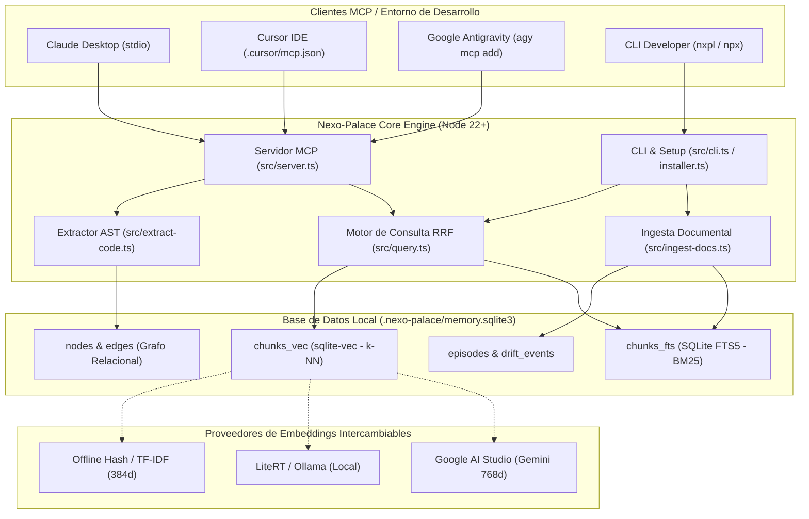

# Nexo-Palace — Documentación de Arquitectura Visual

Este directorio contiene la documentación visual e interactiva de la arquitectura de **Nexo-Palace**, compilada utilizando la herramienta [Archify](https://github.com/tt-a1i/archify).

---

## 🗺️ Mapa de Diagramas Interactivos (HTML Autónomos)

Cada diagrama ha sido compilado como un archivo HTML autónomo e interactivo con soporte de modo oscuro/claro, zoom, paneo, resaltado de dependencias y filtrado por capas:

| Diagrama | Tipo Archify | Fuente JSON | Visualizador Interactivo | Descripción |
| :--- | :--- | :--- | :--- | :--- |
| **Arquitectura Global** | `architecture` | [nexo-palace-architecture.json](file:///Users/jonathanquishpe/JoniDev/JonyDevProjects/nexo-palace/docs/architecture/nexo-palace-architecture.json) | [Abrir Diagrama HTML](file:///Users/jonathanquishpe/JoniDev/JonyDevProjects/nexo-palace/docs/architecture/nexo-palace-architecture.html) | Componentes de Ingesta, AST, SQLite, Motor MCP y Clientes IA. |
| **Búsqueda Híbrida y Fallback** | `workflow` | [hybrid-search-fallback.workflow.json](file:///Users/jonathanquishpe/JoniDev/JonyDevProjects/nexo-palace/docs/architecture/hybrid-search-fallback.workflow.json) | [Abrir Diagrama HTML](file:///Users/jonathanquishpe/JoniDev/JonyDevProjects/nexo-palace/docs/architecture/hybrid-search-fallback.html) | Ejecución desacoplada de canales léxico y vectorial con tolerancia a fallos. |
| **Modelo de Datos SQLite** | `erd` | [memory-database.erd.json](file:///Users/jonathanquishpe/JoniDev/JonyDevProjects/nexo-palace/docs/architecture/memory-database.erd.json) | [Abrir Diagrama HTML](file:///Users/jonathanquishpe/JoniDev/JonyDevProjects/nexo-palace/docs/architecture/memory-database.html) | Tablas relacionales, virtuales (`FTS5` y `vec0`) e índices de `memory.sqlite3`. |

---

## 1. Arquitectura Global del Sistema

Nexo-Palace convierte el código fuente, la documentación y las convenciones de cualquier proyecto en un grafo de conocimiento y memoria unificada local sin depender de clústeres externos:



---

## 2. Flujo de Búsqueda Híbrida y Fallback Léxico

Uno de los principios de diseño fundamentales de Nexo-Palace es el **desacoplamiento total entre el canal léxico y el espacio vectorial**:

1. **Paralelismo:** Toda consulta entrante (`memory_query` o `nxpl query`) bifurca la ejecución en dos canales paralelos e independientes.
2. **Canal Léxico (FTS5):** Tokeniza la búsqueda y consulta `chunks_fts` calculando el ranking BM25, más una comprobación de coincidencia exacta (`LIKE`) para identificadores críticos (`RF-xx`, `US-xx`, nombres de métodos y clases).
3. **Canal Vectorial (`sqlite-vec`):** Calcula el vector de la consulta vía `provider.embed()` y busca los vecinos más cercanos en `chunks_vec`.
4. **Resiliencia & Fallback:** Si la llamada al proveedor vectorial falla (por ejemplo, sin conexión a internet, cuota de API agotada o sandbox cerrado con `Error: fetch failed`), el bloque vectorial se captura en un bloque `catch` seguro. **El canal léxico responde al 100% de la consulta sin degradar ni alterar la base de datos vectorial en disco**.
5. **Fusión RRF (*Reciprocal Rank Fusion*):** Si ambos canales tienen éxito, el ranking final combina ambas señales con la fórmula:
   $$\text{Score} = \frac{1}{60 + \text{rank}_{\text{lex}}} + \frac{1}{60 + \text{rank}_{\text{vec}}} + \text{boost}_{\text{literal}}$$

---

## 3. Estructura de la Base de Datos (`.nexo-palace/memory.sqlite3`)

Toda la memoria reside en un único archivo SQLite:

* **`nodes`**: Entidades del proyecto (`type: doc | code | test | taste | requirement | decision`).
* **`edges`**: Relaciones dirigidas del grafo (`implements`, `tests`, `contains`, `depends_on`).
* **`chunks`**: Fragmentos de texto normalizados con jerarquía de encabezados Markdown y código.
* **`chunks_fts`**: Tabla virtual **FTS5** con índices invertidos y soporte BM25 diacrítico.
* **`chunks_vec`**: Tabla virtual **`vec0`** de `sqlite-vec` que almacena los arrays de punto flotante `float[dim]` para búsqueda semántica.
* **`episodes`**: Registro cronológico de decisiones arquitectónicas tomadas por los agentes (`memory_record_decision`).
* **`drift_events`**: Registro de deriva entre código y especificaciones detectada durante la integración.
* **`meta`**: Parámetros del índice, modelo activo y fecha de cartografía.

---

## 🛠️ Cómo Recompilar los Diagramas con Archify

Si modificas las especificaciones JSON en `docs/architecture/`, puedes regenerar los archivos HTML ejecutando:

```bash
# Compilar Diagrama de Arquitectura Global
node .archify-tool/archify/bin/archify.mjs render architecture \
  docs/architecture/nexo-palace-architecture.json \
  docs/architecture/nexo-palace-architecture.html --quality standard

# Compilar Flujo de Búsqueda y Fallback
node .archify-tool/archify/bin/archify.mjs render workflow \
  docs/architecture/hybrid-search-fallback.workflow.json \
  docs/architecture/hybrid-search-fallback.html --quality standard

# Compilar Diagrama ERD de SQLite
node .archify-tool/archify/bin/archify.mjs render erd \
  docs/architecture/memory-database.erd.json \
  docs/architecture/memory-database.html --quality standard
```
