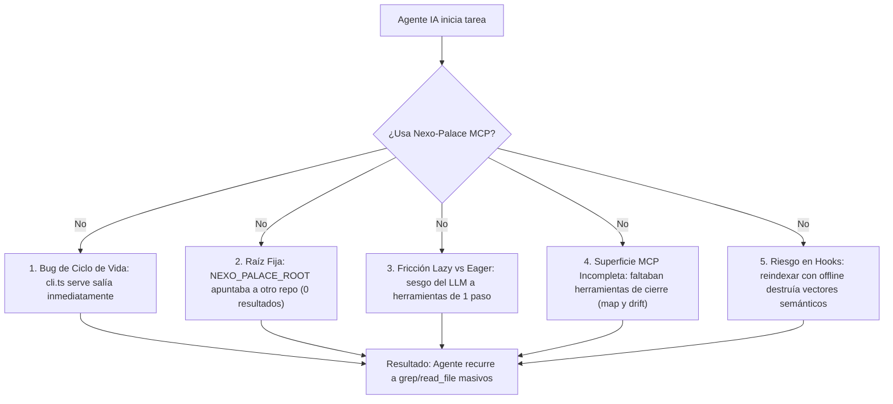

# Hallazgos de Arquitectura y DX: Adopción Activa del Servidor MCP por Agentes de IA

**Fecha:** 16 de Noviembre de 2026  
**Módulos Afectados:** Servidor MCP (`src/server.ts`), Orquestación de Cartografía (`src/map.ts`), Integración de Agentes (`src/agent-integration.ts`), CLI (`src/cli.ts`), Instalador (`src/installer.ts`), Detección de Deriva (`src/drift.ts`)  
**Registro de Decisión:** `decision:2026-11-15T23-27-05-604Z` en [docs/decisions.md](file:///Users/jonathanquishpe/JoniDev/JonyDevProjects/nexo-palace/docs/decisions.md)  
**Rama de Trabajo:** `feature/mcp-agent-adoption`

---

## 1. Contexto y Problema Detectado (El Issue)

Durante el ciclo de desarrollo y en múltiples sesiones de trabajo con agentes autónomos (Google Antigravity `agy`, Cursor, Claude Code, Copilot), se detectó un patrón recurrente de subutilización:

> *«En el proyecto se han realizado tareas de exploración y edición, pero en muchas de las tareas no han utilizado el MCP nexo-palace para explorar o para mapear los cambios o agregar las decisiones.»*

El agente recurría de forma sistemática a comandos de terminal costosos y ciegos (`grep -rn`, `find`, múltiples lecturas completas de archivos con `read_file` o `cat`), ignorando la memoria activa precomputada, la búsqueda híbrida y el grafo de trazabilidad provistos por Nexo-Palace.

---

## 2. Análisis de Causa Raíz: Los 5 Hallazgos Críticos

Una auditoría profunda del código, de los protocolos de transporte MCP y del comportamiento de los LLMs reveló que este problema no se debía a una sola causa, sino a la conjunción de cinco factores técnicos y de diseño:



---

### Hallazgo 1: Bug Crítico de Ciclo de Vida en el Subcomando `serve` (`src/cli.ts`)

* **Síntoma:** Al arrancar el servidor MCP mediante el comando empaquetado recomendado (`npx @ijonydev/nexo-palace serve` o `nxpl serve`), el proceso terminaba con código `0` en menos de un segundo si la entrada estándar no emitía eventos de inmediato.
* **Causa técnica:** En `src/cli.ts`, la rama `case "serve":` ejecutaba:
  ```typescript
  if (command === "serve") {
    await startServer();
    return 0; // ❌ Provocaba que main() resolviera y ejecutara closeDb(); process.exit(0)
  }
  ```
* **Impacto:** Cualquier cliente que lanzara `serve` a través del ejecutable CLI experimentaba una desconexión silenciosa del transporte stdio antes de poder invocar herramientas, obligando al agente a hacer fallback a herramientas nativas.
* **Corrección:** Se implementó una promesa de bloqueo en `src/cli.ts` que mantiene vivo el proceso escuchando activamente los eventos `end` y `close` de `process.stdin` y el callback `server.server.onclose`.

---

### Hallazgo 2: Acoplamiento de Raíz Estática vs. Soporte de MCP Roots (`src/server.ts`, `src/installer.ts`)

* **Síntoma:** Al abrir un proyecto distinto (p. ej. `nexo-menu`), el servidor MCP consultaba la base SQLite del proyecto de origen (p. ej. `nexo-palace`), devolviendo 0 resultados de búsqueda semántica y de grafo.
* **Causa técnica:**
  1. Configuraciones manuales o heredadas inyectaban `"NEXO_PALACE_ROOT": "/Users/.../nexo-palace"` en variables de entorno fijas del cliente MCP (`~/.gemini/antigravity/mcp_config.json`).
  2. El servidor MCP evaluaba `process.cwd()` una sola vez durante el arranque y no escuchaba las capacidades de espacio de trabajo del protocolo MCP.
* **Corrección:**
  1. Se implementó soporte nativo para **MCP Roots** en `src/server.ts`:
     - Consulta automática de raíces de trabajo vía `server.server.listRoots()` al recibir `oninitialized`.
     - Suscripción reactiva a `RootsListChangedNotificationSchema` para re-vincular en caliente el proyecto (`rebindProject`) si el usuario cambia de carpeta en el IDE.
     - Función `pickWorkspaceRoot` que prioriza directorios que ya cuentan con `nexo-palace.config.json` o `.nexo-palace/`.
  2. Se añadió saneamiento automático en `src/installer.ts` para detectar y purgar variables `NEXO_PALACE_ROOT` estáticas en configuraciones legacy (`~/.gemini/antigravity/mcp_config.json`).

---

### Hallazgo 3: Asimetría en la Superficie MCP (Faltaban Herramientas de Cierre)

* **Síntoma:** Aunque el agente pudiera consultar (`memory_query`) y trazar (`memory_trace`), no tenía ninguna herramienta MCP para **sincronizar el índice** (`memory_map`) tras editar código, ni para **auditar el impacto en requisitos** (`memory_drift`).
* **Impacto:** El agente se veía obligado a salir del canal MCP para ejecutar comandos de consola con `run_command` o simplemente omitía la sincronización, provocando desalineación del índice y pérdida de confianza del modelo en futuras consultas.
* **Corrección:**
  - Se unificó la lógica de cartografía en un módulo compartido `src/map.ts` (`runMap`).
  - Se incorporaron **`memory_map`** y **`memory_drift`** como herramientas nativas oficiales de la superficie MCP en `src/server.ts`, completando el ciclo virtuoso de 3 fases (Exploración → Decisión → Cierre).
  - Se adaptó `src/drift.ts` para que las consultas con `dryRun: true` (por defecto) no inserten registros espurios en `drift_events`.

---

### Hallazgo 4: Peligro de Destrucción de Vectores en Automatizaciones de Git Hooks (`src/db.ts`, `src/map.ts`)

* **Síntoma:** La propuesta preliminar sugería un hook `post-commit` con `npx @ijonydev/nexo-palace map --provider offline`.
* **Riesgo crítico:** En un proyecto indexado originalmente con proveedores semánticos reales (Gemini o LiteRT con dimensión 768), forzar `--provider offline` activa `ensureVecTable(db, 384, 'offline:hash-tfidf', { allowSwitch: true })`, lo que **destruye la tabla `chunks_vec` y borra permanentemente todos los embeddings semánticos** precalculados.
* **Corrección:**
  - Se diseñó el modo **`--best-effort`** en `src/map.ts` y `src/cli.ts`:
    - Si el proveedor original con el que se creó el índice está disponible, actualiza los fragmentos modificados conservando la integridad de los vectores.
    - Si el proveedor remoto no está disponible (ej. commit offline sin red o cuota agotada), omite la regeneración de vectores de forma segura sin romper el commit ni destruir la base de datos existente.
  - Los Git hooks automáticos generados por Nexo-Palace utilizan exclusivamente `map --best-effort` y `drift --dry-run` / `drift --strict`.

---

### Hallazgo 5: Fricción Cognitiva de Herramientas Lazy y Sesgo del LLM

* **Síntoma:** En arneses donde las herramientas MCP se montan en modo *Lazy* (como Antigravity), el agente debe solicitar el esquema mediante llamadas intermedias. El modelo, buscando el camino de menor costo de tokens y menor latencia, prefiere herramientas nativas de 1 paso (`run_command` con grep o `read_file`).
* **Corrección:** Se implementó una estrategia de **Agent Steering & Direct Injection** a través de:
  1. `McpServer.instructions`: Directiva explícita de prioridad inyectada en el saludo de capacidades MCP.
  2. Reglas jerárquicas con alta prioridad (`alwaysApply: true` en Cursor `.mdc`, directiva `AGENTS.md` en Antigravity y `CLAUDE.md`).
  3. Hook de ciclo de vida `SessionStart` en Antigravity (`hooks.json` + `hooks/session-start.cjs`) que inyecta en el prompt del sistema la firma exacta de las 6 herramientas MCP en el primer turno de conversación.

---

## 3. Resumen de la Solución Implementada

```text
nexo-palace/
├── src/
│   ├── agent-integration.ts   # [NUEVO] Generador multi-harness, reglas, hooks y scripts
│   ├── map.ts                 # [NUEVO] Motor unificado de cartografía con bestEffort
│   ├── server.ts              # [ACTUALIZADO] MCP Roots, memory_map, memory_drift, memory_status enriquecido
│   ├── cli.ts                 # [ACTUALIZADO] Fix serve lifecycle, init-agent, --best-effort, --strict
│   ├── installer.ts           # [ACTUALIZADO] Limpieza legacy mcp_config.json y paso init-agent en setup
│   └── drift.ts               # [ACTUALIZADO] Soporte idempotente para dry-run sin mutar drift_events
├── tests/unit/
│   ├── agent-integration.test.ts  # [NUEVO] 7 tests de generación e idempotencia
│   └── mcp-server.test.ts         # [NUEVO] 5 tests de MCP roots en memoria, map y drift
└── AGENTS.md                  # [NUEVO] Protocolo de memoria activa en la raíz del motor
```

### Comandos Nuevos y Actualizados del CLI

```bash
# 1. Configuración de agentes en cualquier proyecto consumidor:
npx @ijonydev/nexo-palace init-agent [--harness all|antigravity|cursor|claude|copilot] [--dry-run]

# 2. Cartografía segura no destructiva (ideal para Git hooks):
npx @ijonydev/nexo-palace map --best-effort

# 3. Detección de deriva estricta para pre-push y CI/CD (exit code 1 si hay desalineación):
npx @ijonydev/nexo-palace drift --strict

# 4. Servidor MCP persistente con resolución dinámica de workspace:
npx @ijonydev/nexo-palace serve
```

---

## 4. Matriz de Validación de Calidad

| Validación | Comando | Resultado |
| :--- | :--- | :--- |
| **Tipado estricto** | `npm run typecheck` | ✅ 0 errores de TypeScript (`tsc --noEmit`) |
| **Pruebas unitarias** | `npm run test:unit` | ✅ 10 suites, **74 tests pasando** (100%) |
| **Smoke test MCP (stdio)** | `npm test` | ✅ **20 comprobaciones pasando** (6 herramientas, modo `phase1`, `cli.ts serve` dinámico) |
| **Cartografía viva** | `npm run palace:map` | ✅ Sincronizados 17 documentos (248 fragmentos), 30 ficheros (107 símbolos, 10 tests), 127 aristas |
| **Empaquetado NPM** | `npm pack --dry-run` | ✅ 71 archivos empaquetados en `dist/` y `src/` sin dependencias huérfanas |

---

## 5. Próximos Pasos Recomendados

1. **Promoción a `develop`:** Fusionar la rama `feature/mcp-agent-adoption` en `develop` tras la revisión del equipo.
2. **Preparación de versión `v0.1.4`:** Publicar en NPM para que cualquier proyecto consumidor pueda invocar `npx @ijonydev/nexo-palace init-agent`.
3. **Plantilla de CI/CD para Proyectos Consumidores:** Extender `init-agent` con una opción opcional `--github-action` que genere un workflow para ejecutar `palace:drift` en pull requests.
